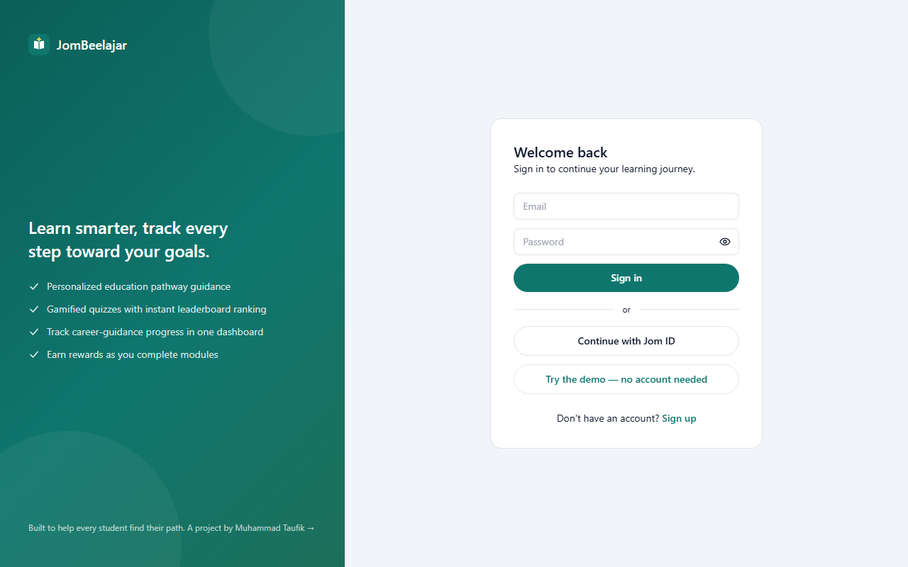
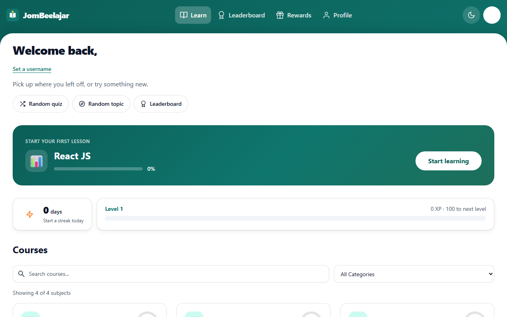
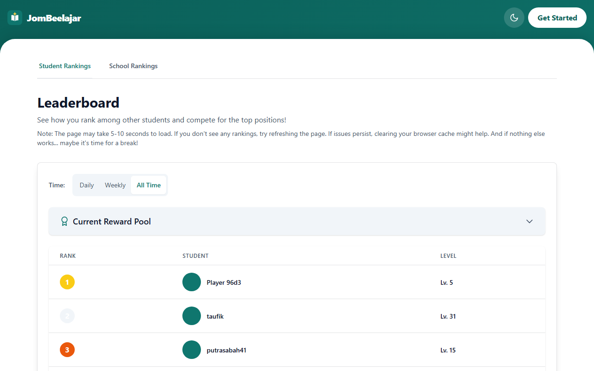
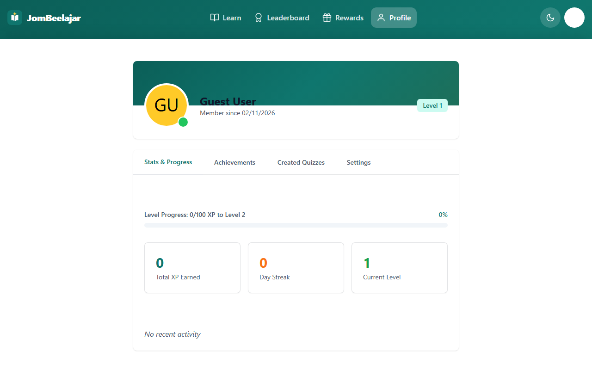
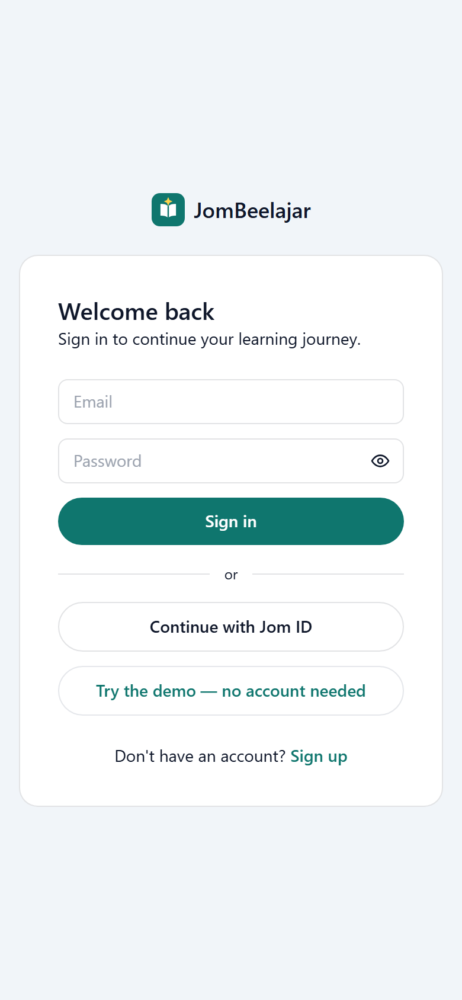

# JomBeelajar

[](https://github.com/taufikhamid2000/JomBeelajar/actions/workflows/ci.yml)
[](https://github.com/taufikhamid2000/JomBeelajar/actions/workflows/test.yml)
[](https://github.com/taufikhamid2000/JomBeelajar/actions/workflows/e2e.yml)


**Test coverage (honest numbers):** 147 Jest tests; overall statements 7.92%, branches 5.80%, functions 4.79%, lines 8.09%. Most UI and route code is still untested. The security-critical paths are covered much higher and pinned in `config/jest.config.mjs`: the quiz answer-check route (96% lines), `requireAdmin` (95%), session helpers and the admin client (100%), and the admin auth service (100%). CI fails if coverage drops below those floors.

A gamified learning platform for Malaysian SPM students: browse subjects, chapters and topics, take quizzes, earn XP and achievements, and climb the leaderboards.

**Live site:** https://jombeelajar.taufikhamid.com

Sign-in uses the shared Jom ID account. The dashboard, profile and quiz submission need a signed-in session; the public pages (about, leaderboards, career guidance, privacy, terms) work without one.

## Try the demo

The sign-in page has a **Try the demo, no account needed** button. It starts a Supabase anonymous session (`supabase.auth.signInAnonymously()` in `src/app/auth/page.tsx`) and opens the dashboard as a "Guest User" with no email or password. It is the quickest way to look around the signed-in app. Guest sessions are not tied to a Jom ID account.

## Screenshots

Captured from a local build of the teal redesign. The dashboard and profile are shown as a guest demo user (empty progress).











## Tech stack

- Next.js 15 (App Router), React 19, TypeScript, Tailwind CSS
- Supabase (auth + Postgres) with a shared cross-app session cookie
- ASP.NET Core API (JomBeelajar-API, hosted on Render) for quiz and content logic
- TanStack Query, react-hook-form, date-fns
- Jest + React Testing Library, Playwright smoke tests
- Deployed on Vercel; CI on GitHub Actions (lint and Jest, E2E, and a scheduled keepalive ping for the API)

See [docs/ARCHITECTURE.md](docs/ARCHITECTURE.md) for how the pieces fit together.

## Run locally

Requires Node.js 20+ and a Supabase project whose schema matches `supabase/migrations`.

```bash
npm install
cp .env.example .env.local   # then fill in the values
npm run dev                  # http://localhost:3000
```

Environment variables (see `.env.example`):

| Variable | Needed for |
| --- | --- |
| `NEXT_PUBLIC_SUPABASE_URL`, `NEXT_PUBLIC_SUPABASE_ANON_KEY` | Everything |
| `SUPABASE_SERVICE_ROLE_KEY` | Server-only admin features |
| `SUPABASE_URL` | Optional server-side fallback for the Supabase URL |
| `JOMBEELAJAR_API_URL` | Calls to the JomBeelajar API |
| `SUPABASE_DB_URL` | `npm run db:migrate` only |
| `E2E_TEST_EMAIL`, `E2E_TEST_PASSWORD` | Signed-in E2E specs (optional) |

Other commands:

```bash
npm run build         # production build (also type-checks)
npm test              # Jest unit/component tests
npm run test:e2e      # Playwright smoke tests (needs a production build)
npm run lint
npm run db:migrate    # apply a migration via scripts/apply-migration.mjs
```

## Documentation

See [docs/README.md](docs/README.md) for the index. [TESTING_CHECKLIST.md](TESTING_CHECKLIST.md) is the manual QA checklist for releases.

---
Built by [Muhammad Taufik](https://taufikhamid.com)
