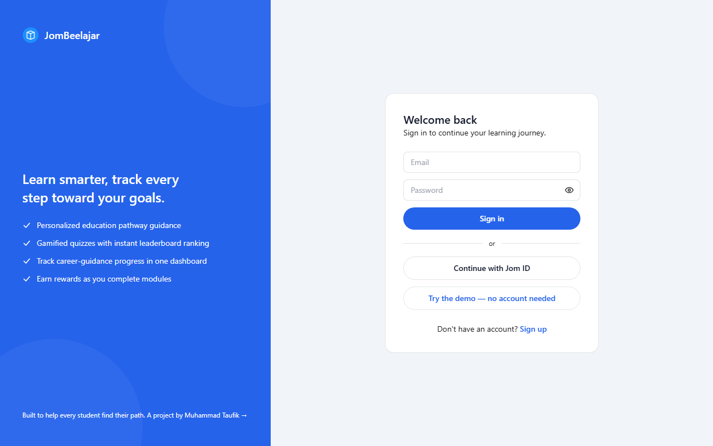
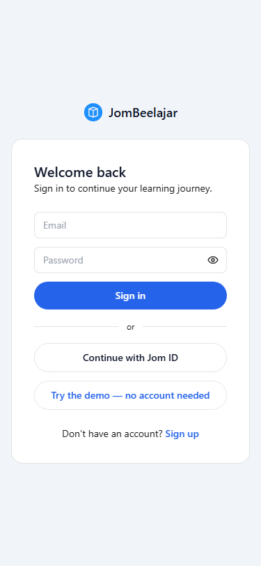

# JomBeelajar

[](https://github.com/taufikhamid2000/JomBeelajar/actions/workflows/ci.yml)
[](https://github.com/taufikhamid2000/JomBeelajar/actions/workflows/test.yml)
[](https://github.com/taufikhamid2000/JomBeelajar/actions/workflows/e2e.yml)

A gamified learning platform for Malaysian SPM students: browse subjects, chapters and topics, take quizzes, earn XP and achievements, and climb the leaderboards.

**Live site:** https://jombeelajar.taufikhamid.com

Sign-in uses the shared Jom ID account. Most of the app (dashboard, profile, quiz submission) needs an account; the public pages (landing, about, leaderboards, career guidance) work without one.

## Screenshots

Public pages of the live site (the sign-in page is what visitors see first).





## Tech stack

- Next.js 15 (App Router), React 19, TypeScript, Tailwind CSS
- Supabase (auth + Postgres) with a shared cross-app session cookie
- ASP.NET Core API (JomBeelajar-API, hosted on Render) for quiz and content logic
- TanStack Query, react-hook-form, date-fns
- Jest + React Testing Library, Playwright smoke tests
- Deployed on Vercel; CI on GitHub Actions

See [docs/ARCHITECTURE.md](docs/ARCHITECTURE.md) for how the pieces fit together.

## Run locally

Requires Node.js 20+ and a Supabase project whose schema matches `supabase/migrations`.

```bash
npm install
cp .env.example .env.local   # then fill in the values
npm run dev                  # http://localhost:3000
```

Environment variables (see `.env.example`):

| Variable | Needed for |
| --- | --- |
| `NEXT_PUBLIC_SUPABASE_URL`, `NEXT_PUBLIC_SUPABASE_ANON_KEY` | Everything |
| `SUPABASE_SERVICE_ROLE_KEY` | Server-only admin features |
| `JOMBEELAJAR_API_URL` | Calls to the JomBeelajar API |
| `SUPABASE_DB_URL` | `npm run db:migrate` only |
| `E2E_TEST_EMAIL`, `E2E_TEST_PASSWORD` | Signed-in E2E specs (optional) |

Other commands:

```bash
npm run build         # production build (also type-checks)
npm test              # Jest unit/component tests
npm run test:e2e      # Playwright smoke tests (needs a production build)
npm run lint
npm run db:migrate    # apply a migration via scripts/apply-migration.mjs
```

## Documentation

See [docs/README.md](docs/README.md) for the index. [TESTING_CHECKLIST.md](TESTING_CHECKLIST.md) is the manual QA checklist for releases.

---
Built by [Muhammad Taufik](https://taufikhamid.com)
