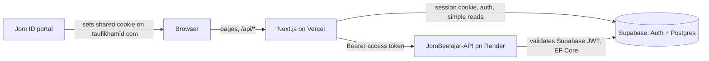

# Architecture

JomBeelajar is a Next.js web client over a Supabase Postgres database and a separate
ASP.NET Core API (JomBeelajar-API)
that owns the quiz and content business logic.

## Next.js app

- App Router under `src/app`. Pages live in the `(app)` route group (dashboard, quiz,
  leaderboard, schools, profile, rewards, admin, career pages). `src/app/auth` is the
  sign-in page.
- `src/app/api/**` are Route Handlers. The browser only ever calls these same-origin
  routes; it never talks to the backend API directly.
- `src/components` (UI, quiz player, dashboard, admin), `src/hooks`, `src/services`
  (client-side data helpers) and `src/lib` (clients, session, logging, env checks).
- `src/middleware.ts` builds a Supabase server client on each request to refresh the
  session cookie and sets `no-store` cache headers.
- Server state on the client is cached with TanStack Query.

## API split

Business logic (quizzes, questions, attempts, progress, leaderboard, audit comments,
achievements, schools, content tree) lives in the ASP.NET Core (.NET 10) service
JomBeelajar-API, deployed on Render and served at `jombeelajar-api.taufikhamid.com`. It maps onto the
same Postgres schema; this repo's `supabase/migrations` remain the schema source of truth.

All calls go through `src/lib/jombeelajar-api.ts`: typed functions over one `apiFetch`
helper that prefixes `JOMBEELAJAR_API_URL`, adds `Authorization: Bearer <token>` when a
token is given, and throws `JomBeelajar API <status>: <path>` on non-2xx so route
handlers can map `404`/`403` to proper responses. Route handlers get the token from
`src/lib/serverSession.ts` (`getSessionToken`). A scheduled GitHub Action pings
`/health` every 10 minutes so the free Render instance stays awake.

## Supabase and the shared Jom ID session

Supabase provides auth and Postgres (schema `edubridge`). Some route handlers still read
Supabase directly (dashboard, profile, user stats); the rest delegate to the API.

All Jom apps share one Supabase project. `src/lib/supabase/cookie-options.ts` writes the
session cookie on the parent domain `.taufikhamid.com` in production, so signing in at the
Jom ID portal signs you in on every app and signing out anywhere signs you out everywhere.
On localhost and preview deployments it falls back to host-only cookies.
`legacy-cookies.ts` expires older host-only cookies. Server code only reads the session;
`src/middleware.ts` is what refreshes and writes it.

## Quiz flow

1. The subject, chapter, topic and quiz pages load content via `/api/*` routes backed by
   the API.
2. `QuizPlayer` fetches the quiz (`GET /api/quiz/[quizId]`). Correct answers are never
   sent to players.
3. After each question the player posts to `/api/quiz/[quizId]/check` for per-question
   feedback. Guests may play, so this route forwards a token only when a session exists.
4. On finish it posts all answers and time taken to `/api/quiz/[quizId]/submit`, which
   requires a session (401 otherwise) and forwards to the API's attempt endpoint. The API
   scores the attempt and handles XP, progress and achievements. Unverified quizzes award
   no points.
5. Authors create quizzes and questions through the author routes, which use an
   author-only view that includes `isCorrect`. Admins verify quizzes and audit content.

## Testing

- **Unit and component tests**: Jest with React Testing Library in `src/__tests__`
  (components, hooks, lib, services, API route handlers). Network boundaries are mocked.
  Config is in `config/jest.config.mjs`. Run `npm test`.
- **E2E smoke tests**: Playwright in `e2e/`, run against a production build
  (`next start`). Every public page must load without a page error or error boundary.
  The signed-in pages (`/dashboard`, `/profile`) run only when `E2E_TEST_EMAIL` and
  `E2E_TEST_PASSWORD` are set, and skip otherwise. Run `npm run test:e2e`.
- `TESTING_CHECKLIST.md` is the manual pre-release checklist.

## CI

| Workflow | Trigger | What it does |
| --- | --- | --- |
| `ci.yml` | push to main, PRs | `npm ci`, ESLint, Jest with dummy env values |
| `test.yml` | push to main, PRs | `npm ci`, `npm test`, `npm run lint` |
| `e2e.yml` | push to main, manual | Build and run Playwright smoke tests; skipped when Supabase repo secrets are missing |
| `keepalive.yml` | every 10 minutes | Pings the API `/health` endpoint |

Type errors fail `next build` (`ignoreBuildErrors` is off), so the Vercel build is the
type-check gate.
